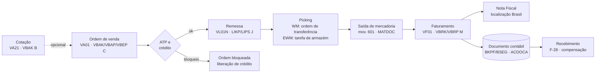
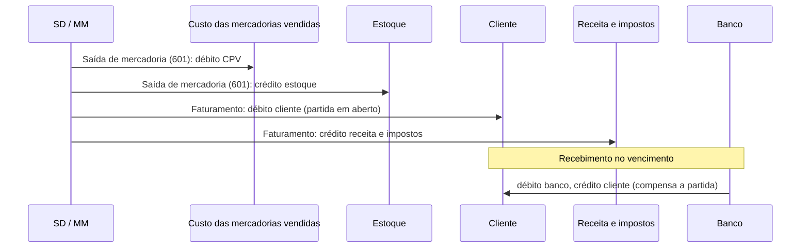
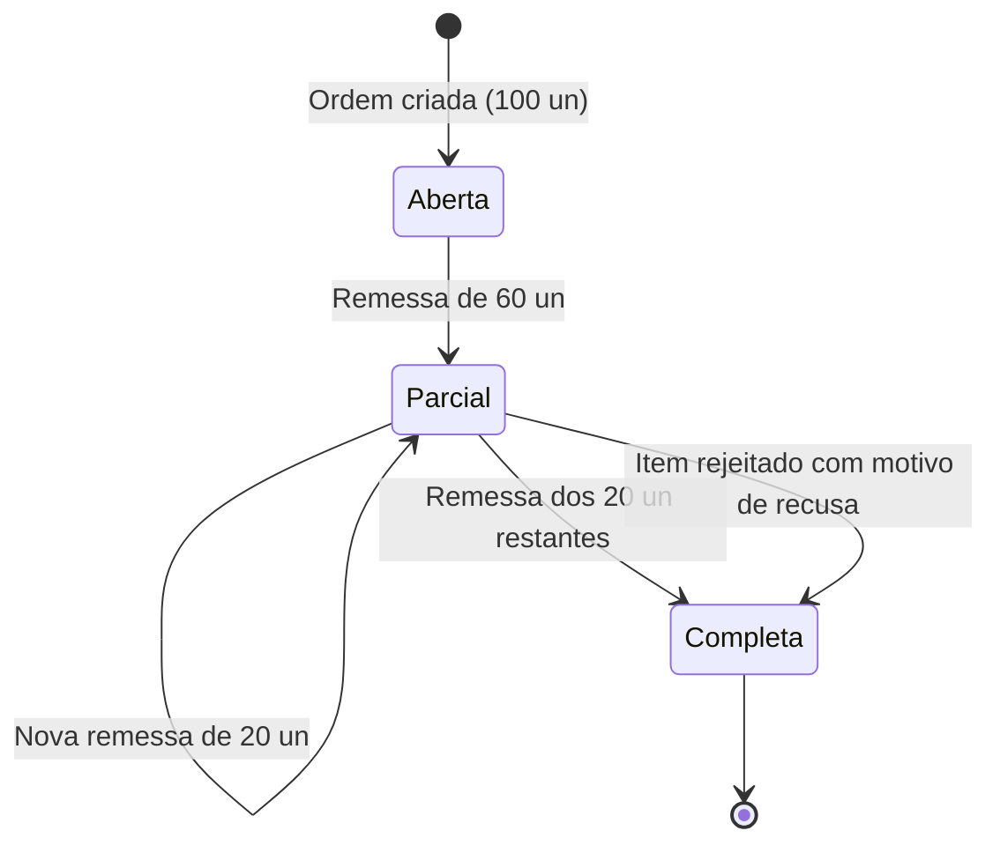

# SAP Order-to-Cash - Study

> Nível: prática
> O fluxo de vendas ponta a ponta (cotação, ordem, remessa, picking, faturamento e recebimento), atravessando
> SD, WM/EWM e FI. Relacionados: [SAP-SD-erp-study](https://github.com/igor-barral/SAP-SD-erp-study),
> [SAP-FI-erp-study](https://github.com/igor-barral/SAP-FI-erp-study), [SAP-MM-erp-study](https://github.com/igor-barral/SAP-MM-erp-study),
> [SAP-WM-erp-study](https://github.com/igor-barral/SAP-WM-erp-study), [SAP-EWM-erp-study](https://github.com/igor-barral/SAP-EWM-erp-study),
> [SAP-Business-Partner-erp-study](https://github.com/igor-barral/SAP-Business-Partner-erp-study),
> [SAP-Procure-to-Pay-erp-study](https://github.com/igor-barral/SAP-Procure-to-Pay-erp-study).

## Objetivo

Order-to-Cash (O2C) é o processo que começa na negociação com o cliente e termina com o dinheiro na conta. É
o processo com mais integrações em projetos SAP (e-commerce, força de vendas, transportadora, banco, emissão
fiscal) e o que mais gera chamado de suporte: ordem que não gera remessa, remessa que não fatura, fatura que
não vai para a contabilidade. Enxergar o fluxo inteiro e o estado de cada documento é o que permite
diagnosticar esses casos.

"Prática" aqui significa percorrer o fluxo com documentos reais no sistema, se houver acesso a um S/4HANA com
dados de demonstração, ou reconstruí-lo pelas tabelas e diagramas deste README; e preencher a seção
"Processos que eu já implementei vs. SAP".

Ao concluir este estudo você deverá ser capaz de responder perguntas como:

- Em que ponto do fluxo a receita é reconhecida?
- O que acontece com a ordem quando a remessa é parcial?
- Onde cada documento do fluxo é gravado?
- Por que uma ordem não gera remessa, ou uma remessa não gera fatura?
- Como o recebimento do cliente fecha o ciclo no FI?
- Onde entram verificação de disponibilidade e verificação de crédito?

## Ponte

| Etapa | Num ERP próprio (típico) | No SAP |
|---|---|---|
| Orçamento | Tabela de orçamentos convertida em pedido | Cotação (`VA21`) com referência na ordem |
| Pedido | Pedido de venda com itens e condições comerciais | Ordem de venda (`VA01`), preço pela técnica de condições |
| Reserva de estoque | Reserva ou baixa na confirmação | Verificação de disponibilidade (ATP) nas divisões |
| Liberação de crédito | Regra de limite no cadastro do cliente | Gestão de crédito com bloqueio da ordem ou remessa |
| Separação e expedição | Romaneio e conferência | Remessa (`VL01N`), picking (WM/EWM), saída de mercadoria |
| Nota fiscal de saída | Emissão da NF-e a partir do pedido | Faturamento (`VF01`) e Nota Fiscal gerada pela localização Brasil |
| Contas a receber | Títulos e boletos | Partida em aberto do cliente no FI |
| Baixa | Retorno bancário baixando o título | Recebimento e compensação (`F-28`, extrato bancário) |

## Conteúdo

### 1. Fluxo de documentos

### 2. Onde cada documento é gravado

| Etapa | Transação (SAP GUI) | Tabelas | Documento contábil? |
|---|---|---|---|
| Cotação | `VA21` / `VA22` / `VA23` | `VBAK`, `VBAP` | Não |
| Ordem de venda | `VA01` / `VA02` / `VA03` | `VBAK`, `VBAP`, `VBEP`, `VBKD`, `VBPA`; condições em `KONV` (ECC) ou `PRCD_ELEMENTS` (S/4HANA) | Não |
| Liberação de crédito | ECC `VKM1` (e relacionadas); S/4HANA apps do SAP Credit Management | status da ordem ou remessa | Não |
| Remessa | `VL01N` / `VL02N` / `VL03N`; em massa `VL10` | `LIKP`, `LIPS` | Não |
| Picking (WM) | `LT03`, `LT12` | `LTAK`, `LTAP` | Não |
| Picking (EWM) | `/SCWM/PRDO`, `/SCWM/MON` | tabelas do EWM | Não |
| Saída de mercadoria | `VL02N` (botão de saída) ou `VL06G` | S/4HANA `MATDOC`; ECC `MKPF`/`MSEG` | Sim: débito custo das mercadorias vendidas, crédito estoque |
| Faturamento | `VF01` / `VF03`; em massa `VF04` | `VBRK`, `VBRP` | Sim: débito cliente, crédito receita e impostos |
| Nota Fiscal (Brasil) | monitor da localização (confirme a transação no projeto) | `J_1BNFDOC`, `J_1BNFLIN` | Não (documento fiscal) |
| Recebimento | `F-28`; extrato bancário | `BKPF`/`BSEG`, `ACDOCA` | Sim: débito banco, crédito cliente (compensa a partida) |
| Fluxo | botão "Fluxo de documentos" em qualquer documento | `VBFA` | - |

### 3. O que acontece na contabilidade

A conta de receita é determinada pela configuração `VKOA` (a partir de dados como grupo de contas do cliente e
do material e a chave de conta da condição). O custo vem da avaliação do material no MM. Ver
[SAP-FI-erp-study](https://github.com/igor-barral/SAP-FI-erp-study).

### 4. Em que ponto a receita é reconhecida

No cenário padrão de venda de mercadoria, a receita é lançada no **faturamento**: é o documento de
faturamento, ao ser transferido para a contabilidade, que credita a conta de receita. A saída de mercadoria
lança apenas custo contra estoque.

Isso cria dois pontos de atenção que aparecem em fechamento:

- **Saída sem fatura**: entre a saída de mercadoria e o faturamento, o custo já foi lançado e a receita ainda
  não. Por isso o faturamento costuma ser feito no mesmo dia (em massa pela `VF04` ou por job).
- **Fatura não transferida à contabilidade**: o documento de faturamento existe, mas o lançamento contábil não
  foi gerado (erro de determinação de contas, período fechado, dados faltando). A `VFX3` lista documentos de
  faturamento bloqueados para a contabilidade.

Normas contábeis como IFRS 15 podem exigir reconhecimento em momento diferente (por exemplo, em contratos com
várias obrigações de desempenho). Para esses casos, o S/4HANA tem uma solução própria de contabilização de
receitas; não é tema deste estudo, mas vale saber que existe e confirmar com o consultor FI.

### 5. Remessa parcial

Quando a remessa não cobre toda a quantidade do item:

- O **status de remessa** do item fica "parcialmente processado", e o saldo continua disponível para uma nova
  remessa (aparece novamente na lista de remessas a criar da `VL10`).
- O faturamento, no cenário baseado em remessa, fatura **o que foi entregue**; cada remessa gera sua fatura
  (ou são agrupadas, conforme configuração).
- Se o cliente não aceita entrega parcial, o **acordo de remessa parcial** e o indicador de **remessa completa**
  (no cadastro do cliente, no registro info cliente-material ou na ordem) impedem que a remessa seja criada com
  quantidade menor. Há também um limite configurável de remessas parciais por item.
- Se o saldo não será mais entregue, o item recebe um **motivo de recusa**, e o status passa a completo.
- No ECC, esses status ficavam em `VBUK`/`VBUP`; no S/4HANA, estão nos campos de status das próprias tabelas
  do documento (`VBAK`, `VBAP`, `LIKP`, `LIPS`).

### 6. Por que o fluxo trava

| Sintoma | Causas mais comuns | Onde olhar |
|---|---|---|
| Ordem não gera remessa | Bloqueio de crédito, bloqueio de remessa no cabeçalho, sem quantidade confirmada no ATP, data de disponibilidade no futuro | Status da ordem (`VA03`), divisões (`VBEP`), log da `VL10` |
| Remessa não permite saída de mercadoria | Picking incompleto, estoque insuficiente no depósito, período do MM fechado | `VL02N`, monitor do WM/EWM |
| Remessa não gera fatura | Saída de mercadoria não lançada, bloqueio de faturamento, log de erros do faturamento | `VF04`, log do faturamento, status da remessa |
| Fatura não vai para a contabilidade | Determinação de contas, período contábil fechado, dados de cliente | `VFX3` |
| Partida do cliente não compensa | Referência do pagamento não identifica a fatura, diferença de valor | `FBL5N`, extrato bancário |

### 7. Rastrear de ponta a ponta

1. Da ordem para frente: `VBFA` com `VBELV` = número da ordem mostra remessas e faturas seguintes.
2. Da fatura para trás: `VBRP-AUBEL` (ordem) e `VBRP-VGBEL` (documento de referência, normalmente a remessa).
3. Da fatura para a contabilidade: `BKPF-AWTYP = 'VBRK'` e `BKPF-AWKEY` = número do documento de faturamento.
4. Do recebimento para a fatura: documento de compensação (`BSEG-AUGBL`) na partida do cliente.

### 8. Pontos típicos de desenvolvimento no O2C

| Tipo RICEFW | Exemplo no O2C |
|---|---|
| R | Carteira de pedidos, remessas pendentes, faturamento por vendedor, aging de clientes |
| I | Ordens vindas do e-commerce; integração com transportadora; retorno bancário; emissão de NF-e |
| C | Carga de clientes (Business Partner), preços (registros de condição), ordens em aberto |
| E | Validação na ordem (em ECC, *user exits* do SD; em S/4HANA, BAdIs liberadas); rotinas de preço |
| F | Confirmação da ordem, romaneio, fatura, etiqueta de expedição |
| W | Liberação de crédito ou de desconto acima da alçada |

Ver o mapa completo em [SAP-RICEFW-erp-study](https://github.com/igor-barral/SAP-RICEFW-erp-study).

## Processos que eu já implementei vs. SAP

> Template para preencher com processos que eu realmente implementei nos ERPs próprios (indústria, logística,
> fiscal). Não preencher com suposições: se um processo não foi implementado, deixe a linha em branco ou
> remova-a. Esta seção vira material de entrevista.

| Processo no meu ERP | ERP / cliente (setor) | Como eu implementei (tabelas, regras, integrações) | Equivalente SAP (documento, transação, tabela) | Diferenças relevantes | O que eu levaria para um projeto SAP |
|---|---|---|---|---|---|
| Orçamento / proposta | | | Cotação · `VA21` · `VBAK`/`VBAP` | | |
| Pedido de venda | | | Ordem · `VA01` · `VBAK`/`VBAP`/`VBEP` | | |
| Tabela de preços e descontos | | | Técnica de condições · `VK11` · `KONP`/`PRCD_ELEMENTS` | | |
| Reserva / disponibilidade de estoque | | | ATP · divisões `VBEP` | | |
| Limite de crédito | | | Gestão de crédito · `UKM_BP` (S/4HANA) | | |
| Separação e romaneio | | | Remessa · `VL01N` · `LIKP`/`LIPS` · picking WM/EWM | | |
| Baixa de estoque na expedição | | | Saída de mercadoria · mov. `601` · `MATDOC` | | |
| Emissão de nota fiscal de saída | | | Faturamento · `VF01` · `VBRK`/`VBRP` + Nota Fiscal da localização | | |
| Contas a receber, boletos | | | Partidas do cliente · `FBL5N` · `BSID`/`ACDOCA` | | |
| Retorno bancário e baixa | | | Recebimento · `F-28` · extrato bancário | | |
| Entrega parcial / saldo de pedido | | | Status de remessa do item · motivo de recusa | | |
| (outro processo) | | | | | |

Perguntas para guiar o preenchimento:

- Onde o meu ERP guardava a ligação pedido → expedição → nota (o equivalente à `VBFA`)?
- A regra de preço era configurável pelo usuário ou estava em código?
- Em que momento o meu ERP gerava receita e custo contábil?
- Como eu tratava pedido entregue em partes e saldo cancelado?

## Respostas

**Em que ponto do fluxo a receita é reconhecida?**
No cenário padrão, no faturamento: o documento de faturamento transferido para o FI credita a receita e
debita o cliente. A saída de mercadoria lança só o custo contra o estoque. Casos regidos por normas como
IFRS 15, com várias obrigações de desempenho, podem usar uma solução própria de contabilização de receitas.

**O que acontece com a ordem quando a remessa é parcial?**
O item fica com status de remessa parcial e o saldo continua disponível para nova remessa. O faturamento
cobra o que foi entregue. Se o cliente não aceita parcial, o acordo de remessa parcial ou o indicador de
remessa completa impede a remessa menor; se o saldo não será entregue, o item recebe motivo de recusa e o
status fica completo.

**Onde cada documento é gravado?**
Cotação e ordem em `VBAK`/`VBAP` (divisões em `VBEP`); remessa em `LIKP`/`LIPS`; picking em `LTAK`/`LTAP` (WM)
ou nas tabelas do EWM; saída de mercadoria em `MATDOC` (ou `MKPF`/`MSEG` no ECC); faturamento em
`VBRK`/`VBRP`; Nota Fiscal em `J_1BNFDOC`/`J_1BNFLIN`; contabilidade em `BKPF`/`BSEG` e `ACDOCA`; ligação
entre documentos de SD em `VBFA`.

**Por que uma ordem não gera remessa, ou uma remessa não gera fatura?**
Ordem: bloqueio de crédito ou de remessa, falta de quantidade confirmada, data futura. Remessa: saída de
mercadoria não lançada, bloqueio de faturamento ou erro no log do faturamento. Ver a tabela da seção 6.

**Como o recebimento fecha o ciclo?**
O pagamento do cliente é lançado (manualmente na `F-28` ou pelo extrato bancário) e compensa a partida em
aberto criada pelo faturamento. A partir daí, a fatura aparece como compensada, com o documento de
compensação.

**Onde entram disponibilidade e crédito?**
Na ordem de venda (e, conforme configuração, novamente na remessa). A verificação de disponibilidade confirma
quantidades e datas nas divisões; a verificação de crédito pode bloquear a ordem ou a remessa até liberação.

## Referências

- SAP Help Portal: https://help.sap.com (busque "Sales", "Billing" e "Accounts Receivable" na documentação do
  SAP S/4HANA).
- SAP Learning: https://learning.sap.com (trilhas introdutórias de Sales no S/4HANA).
- SAP Community: https://community.sap.com (busque "order to cash", "document flow" e "partial delivery").
- SAP Business Accelerator Hub: https://api.sap.com (APIs de Sales Order, Outbound Delivery e Billing Document
  do S/4HANA).
